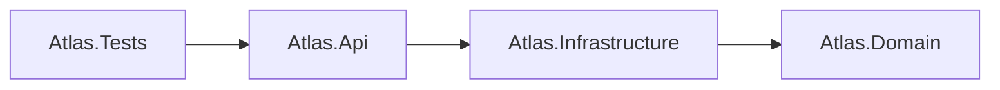
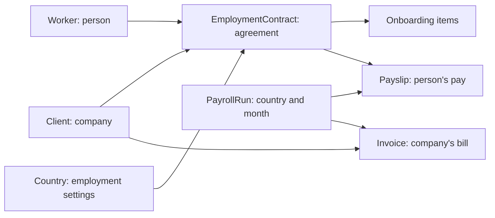
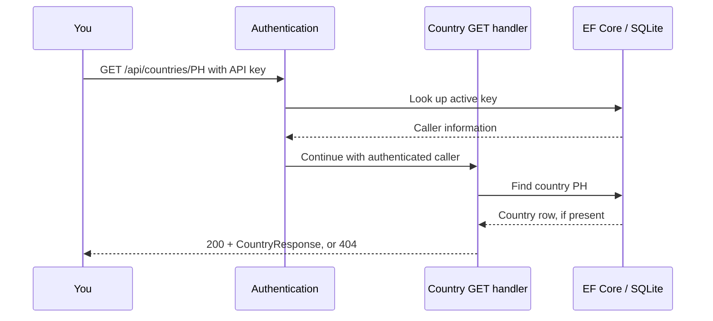

# Three maps of the same codebase

**One objective:** distinguish a project map, a data map, and a request map. They answer different questions.

## Map 1: which project references which?

Arrows show the direct project references in the `.csproj` files. The API also uses domain types made available through its dependencies. This drawing is about code dependencies, not the order every request runs.

Read it aloud: “Tests use the API. The API uses Infrastructure. Infrastructure uses Domain. Domain contains the core types and rules.”

## Map 2: how the main records relate

These arrows mean “related to,” not “exactly one.” A contract has multiple checklist items and can have payslips for many months. A run can have many payslips and an invoice for each involved client.

Read it aloud: “One monthly run has individual payslips. Its invoices group costs by company.”

## Map 3: how a country read returns data

This is the normal authenticated read path. It omits logging and other middleware to keep the first pass small. Notice that authentication itself can read the database.

## Say it again without a diagram

The project map tells you where code belongs. The data map tells you how records connect. The request map tells you what happens over time.

## Checkpoint

Which map helps find the code responsible for an HTTP response? Which helps explain why a contract needs a client ID? Which helps avoid making Domain depend on HTTP?

If Mermaid does not render in your editor, the sentences below each diagram provide the same explanation. Next: [a small file tour](03-file-tour.md).
