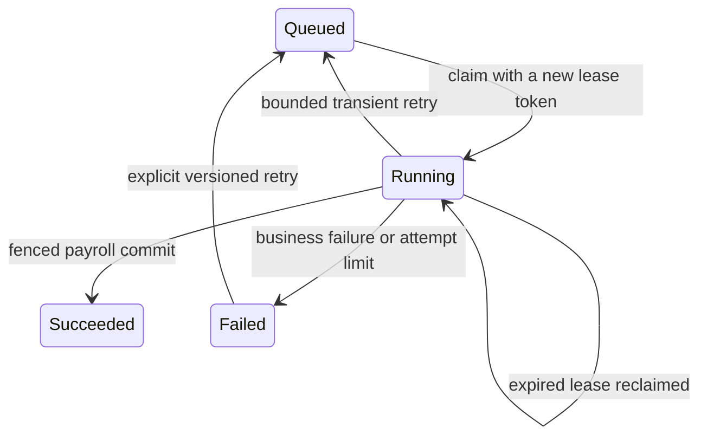

# Lesson 6: Calculate, capture, commit, recover

SS-01–05 extend payroll with simulation, calculation evidence, variance, completion receipts, and durable jobs. This is a larger lesson: use one section per session. Its code is in [PayrollAssessmentCalculator](../../src/Atlas.Domain/Services/PayrollAssessment.cs), [PayrollAssessmentService](../../src/Atlas.Infrastructure/PayrollAssessmentService.cs), [PayrollService](../../src/Atlas.Infrastructure/PayrollService.cs), and [DurableJobService](../../src/Atlas.Infrastructure/DurableJobService.cs). Read [PayrollReliabilityStoryTests](../../tests/Atlas.Tests/Integration/PayrollReliabilityStoryTests.cs) alongside it. The [progress register](progress.md) records verification status.

## Classify the work before extracting it

The original payroll creation method read data, calculated amounts, changed expense statuses, built payslips, and saved. To add simulation, separate those responsibilities deliberately.

| Responsibility | Example | Simulation may do it? |
| --- | --- | --- |
| Read input | Load applicable salary records | Yes |
| Calculate | Compute rounded employer cost | Yes |
| Explain | List a missing FX rate | Yes |
| Change state | Mark an expense Reimbursed | No |
| Capture a fact | Insert a saved payslip | No |
| Commit | Save the run and its effects | No |

It is not enough to call the old method and skip its last SaveChanges. That method could still mutate tracked entities, and some other code might save them later. The assessment path returns plain result records and does not perform the reimbursement transition.

Said another way: a quote calculator can print an estimate without taking money from a wallet. Generating the estimate and recording its consequences are separate operations.

## Trace one expense through simulation and creation

An Approved expense of 50 belongs to a payable contract. Simulate September twice. Both results include 50, and the expense remains Approved. Then create September's run. The saved payslip includes 50 and the expense becomes Reimbursed once.

Find these exact assertions in `SS01_SS02_SimulationDoesNotConsumeInputsAndEvidenceSurvivesSourceChanges`. The test compares each simulation amount to the later saved payslip, then reads the expense state through a fresh context.

The assessment loader selects contracts by country and month coverage, caps them at 1,000 before loading child sets, and loads related data in batches. It then creates `PayrollCalculationInput` records. The pure calculator consumes those records and returns `PayrollMoney`.

Follow one input field at a time. Start with MonthlySalary. Then add employer and employee rates. Only after those are clear, follow expense totals, benefit shares, and final-pay inputs. You do not need to hold every component in memory at once.

## Why there are two blocker lists

An existing run prevents creating another run for the same country and period. It does not prevent an operator from examining a fresh simulation of current inputs.

Missing FX prevents an estimated client invoice in that currency. It does not prevent calculating local gross, deductions, reimbursements, or benefit shares.

The response therefore separates creation blockers from completion blockers. Local calculated values remain available when billing is incomplete. Estimated billing uses the same fee arithmetic as completion, but is labeled an estimate and receives no issued invoice number.

A final-pay contract without a leave policy has a warning and zero unused-leave payout, matching existing behavior. Its absent allowance is not silently described as a known entitlement.

## Preparation still checks whether its input became stale

`PrepareRunAsync` stages the selected payslips, evidence, reimbursement changes, and contract version updates. It does not save them by itself. Its caller owns the transaction and the eventual save.

The preparation checks contract versions and the selected expense versions/statuses against the assessment. If an expense changed or another process already reimbursed it, preparation rejects that stale assessment. The unique country/year/month key also prevents duplicate runs.

This repeats the quote lesson: calculating a proposal does not reserve the input indefinitely. The write path must still protect the assumptions that matter when it commits.

The method's name is not the guarantee. Inspect its callers: synchronous creation starts a transaction, assesses, prepares, saves, and commits. Background processing performs a fenced final transaction. If a future caller only invokes preparation and forgets to save, no run is persisted.

## IDs explain where a value came from; copies explain what it was

Calculation evidence stores the selected salary record ID and its copied amount/date. It also stores country rates, employment dates, final-pay allowance/reservations, expense IDs and amounts, benefit enrollment/plan IDs with applied shares, and the output components.

Keeping only the source ID would be insufficient: a later edit could change what that ID points to. Keeping only an amount would reproduce the arithmetic but make the source choice harder to explain. The evidence contains both.

It deliberately omits receipt URLs, expense narratives, credentials, and unrelated worker documents. The serialized document comes from explicit calculation records rather than serializing every loaded EF entity.

The test changes today's salary, country rate, and plan price after creation. The evidence response stays byte-for-byte equivalent in its JSON representation. That is the behavior a reviewer needs when explaining an old payslip.

## Schema version and calculator version answer different questions

Schema version identifies the shape of the evidence document. Calculator version identifies the business arithmetic that interprets it. A future change to the JSON structure is not necessarily a change to payroll math, and a change to payroll math might leave the JSON fields unchanged.

The evidence reader supports the named version and replays its inputs. It compares the replay with both the captured outputs and the actual saved payslip. An unsupported version is explicit; the reader does not silently run a newer formula against older evidence.

An old payslip without evidence returns `available=false` and `not-captured`. Reconstructing evidence from current tables would make up a historical claim the system did not preserve.

The document is bounded to 256 KiB. If evidence cannot be captured within that bound, creation fails before saving. It does not create an unexplained payslip and hope to attach evidence afterward.

## Test atomicity by failing the last part

One test deliberately makes evidence insertion fail in its isolated database. The expected result is no run, no payslip, no evidence, and an expense still Approved. Another test makes completion-receipt insertion fail and expects the run to remain Draft with no newly issued invoices.

Those failures happen after useful work has been prepared. They test the transaction boundary rather than only a validation branch at the start of a request.

Read the tests before copying any diagnostic SQL. Their temporary triggers belong to disposable test databases. The learning objective is to observe rollback of the entire operation, not to change a practice database accidentally.

## A variance report starts with both sides

Suppose baseline contains contracts A and B, while comparison contains A and C. Starting from only comparison rows would miss B's removal. Starting from only baseline rows would miss C's addition.

The report takes the union of ContractIds and then labels each row added, removed, or retained. Missing amounts become zero only after presence flags are set. A missing payslip remains distinguishable from a present payslip with a zero reimbursement amount.

For costs A=100 and B=50 before, A=120 and C=30 after, the deltas are +20, -50, and +30. They sum to zero, matching 150 minus 150. Repeat that calculation in each currency group separately.

Unused leave payout is displayed as a component already included in GrossSalary. Adding it again while reconciling total cost would count it twice. A numeric increase also does not establish its cause; the report identifies changed components for investigation.

## Completion receipts close a response-loss gap

Imagine completion commits but the client loses the HTTP response. Retrying the same `Idempotency-Key` should return the original successful response, including invoice IDs and timestamps.

[PayrollCompletion](../../src/Atlas.Api/PayrollCompletion.cs) scopes the key by authenticated API-user ID and operation. It fingerprints the normalized run ID, and stores the exact versioned response in the same transaction as completion and invoices. Reusing the key for another run conflicts. A missing-FX failure leaves no receipt, so correcting FX allows the same key to succeed later.

Saving “request succeeded” separately would create another gap: invoices could exist without the receipt, or a receipt could claim success while invoice creation failed. The shared commit removes that gap for this bounded synchronous operation.

The receipt does not make every completion globally exactly once. A different key is a different request identity, and an unkeyed retry retains the existing completed-state conflict. Authorization is still enforced for every replay.

## A durable job is a database record

Submitting a payroll job writes Queued state to SQLite and returns a polling URL. The HTTP request can end before calculation starts. A hosted worker later claims it; a process restart does not erase the queued row.

The job creates a Draft run. It does not issue invoices. A duplicate submission for the same country/period returns the existing job instead of queueing another copy.

## A lease does not physically stop a stale process

Worker A claims a job for 60 seconds. A pauses or loses connectivity. The lease expires and worker B claims it with a new token. A can still be executing code when it wakes up; the lease does not kill A's process.

The final database fence is what matters. A conditional update requires the job's Running state, the worker's current token, and an unexpired lease. That update occurs inside the transaction containing payroll and job success. A stale worker fails the fence and persists no effects.

The test `SS05_ExpiredWorkerCannotCommitAfterAnotherWorkerClaims` performs this schedule using separate contexts over a disposable SQLite file. It checks that A leaves no payroll effects, then B commits one run and its evidence/reimbursements.

The common in-memory API fixture shares one connection. It is useful for request tests, but is insufficient for independently connected worker schedules. The file fixture makes that distinction explicit and disables pooling so it can clean up only its own files afterward.

## Renewal, consistency, and retry bounds

The worker renews through separate contexts while reading/calculating. It never performs concurrent EF operations on one DbContext. SQLite WAL mode allows the consistent input reader and separate lease writes to coexist; the development initializer enables it, and the job test fixture does so explicitly.

A final renewal is followed by the fenced commit. If the worker loses ownership, it leaves recovery to the current owner or later lease reclamation. A synchronous creation that wins meanwhile is reported as `run-already-exists` with the run ID.

Each submission or explicit retry cycle allows at most three claims, including expired-lease recovery. Explicit retry resets the cycle count while preserving total attempts. A permanently failing job cannot spin forever without an operator decision.

The hosted worker is disabled in the Testing environment so tests control its steps directly. `Jobs:Enabled=false` disables automatic processing for deliberate manual operation. Production use still needs the documented database/schema setup; a passing fresh-schema test is not an upgrade procedure for an older database.

## Recall without the code

Explain these four steps twice, first to an operator and then to an engineer:

1. **Calculate:** inspect a coherent set of inputs without consuming expenses.
2. **Capture:** preserve copied inputs and outputs that explain the payslip.
3. **Commit:** persist the related business facts together or roll them all back.
4. **Recover:** reclaim abandoned work while preventing stale workers from committing.

Then draw the A/B lease timeline from memory. Point to the single operation that prevents A from writing after B takes over. If your answer is only “the lease expired,” reread the fence section and the test's post-failure assertions.
