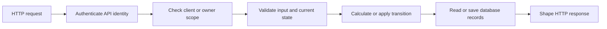
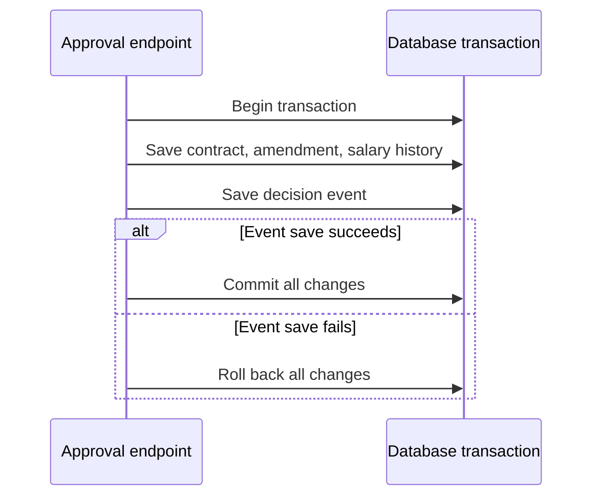
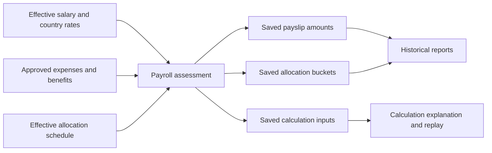
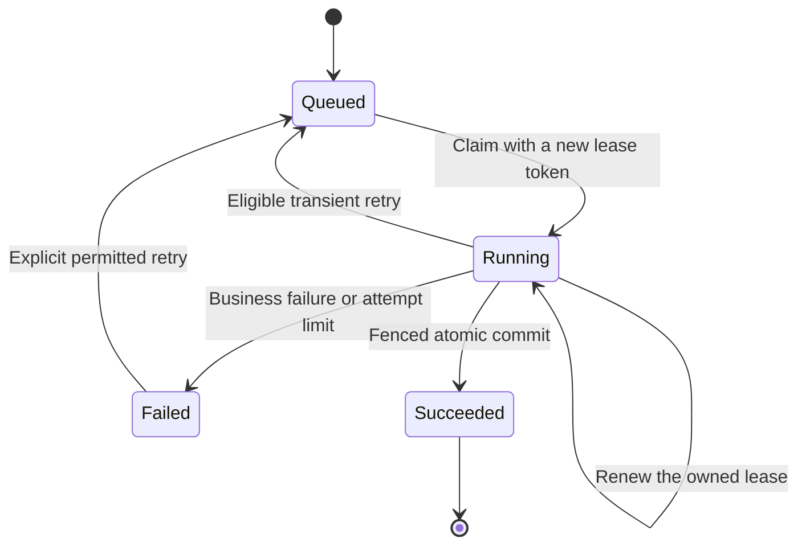

# Four pictures to revisit when the code feels large

Read one picture per session. Explain it in your own words, then trace its named example in the source. These are navigation aids, not substitutes for reading the actual rule or test.

## 1. A request travels through responsibilities

For an invoice payment, authentication answers who is calling. Scope establishes which invoice they may access. Input validation checks the amount, currency, timestamp, and reference. The ledger rule checks whether the payment would overdraw any historical balance. Saving makes the payment and invoice version durable. The response describes the accepted payment.

The actual source can place multiple responsibilities in one endpoint or move them into services. Follow the behavior rather than assuming each box must be a separate class. Start with [InvoiceLedgerEndpoints](../../src/Atlas.Api/Endpoints/InvoiceLedgerEndpoints.cs) and [InvoiceLedgerService](../../src/Atlas.Infrastructure/InvoiceLedgerService.cs).

**Recall prompt:** point to the box that prevents seeing another client's data. Then point to the box that rejects an unsupported amount. They solve different problems.

## 2. Two saves can still be one transaction

“Saved” can be ambiguous in conversation. SQL may have executed inside an open transaction while the final commit has not happened. In this feature, neither the contract change nor the event is durable until the transaction commits.

Think of the transaction as one package containing both the changed state and its promised evidence. The package is accepted together or rejected together. Return from that analogy to [ContractDecisionWriter](../../src/Atlas.Api/ContractDecisionWriter.cs) and locate the two saves and the one commit.

**Recall prompt:** if the event insert fails, name three business records that must not retain the attempted amendment's effects. Check the failure test afterward.

## 3. Configuration, calculation, and evidence are different records

An assessment selects inputs and calculates. A payslip saves outputs. Calculation evidence saves the inputs needed to explain the result. Allocation rows save the department split and labels. Later reports read these saved facts instead of silently recalculating them from today's configuration.

For a smaller everyday example, a shop can change its current price without changing a receipt issued yesterday. The receipt and the current price answer different questions. Payroll evidence is more detailed than a receipt, but the distinction between a current input and a recorded result is the same.

Start with [PayrollAssessmentService](../../src/Atlas.Infrastructure/PayrollAssessmentService.cs), then follow `PrepareRunAsync` in [PayrollService](../../src/Atlas.Infrastructure/PayrollService.cs).

**Recall prompt:** which arrows would be wrong if a historical allocation report joined today's schedule? Explain the user-visible error, not only the query difference.

## 4. A background worker must still own the job when it finishes

There is another possible event while Running: the lease can expire, letting a replacement worker claim a new token. The earlier worker may still be computing. Its final conditional database write must fail because its old token no longer owns the job.

For an export, valid prepared JSON alone is not permission to publish. The worker must still own the unexpired lease and the requester must still have the required access. Artifact insertion and the Succeeded state then commit together.

Start with [DurableJobService](../../src/Atlas.Infrastructure/DurableJobService.cs). Find `ClaimAsync`, `RenewAsync`, and `FenceAsync`. Follow [export commit](../../src/Atlas.Infrastructure/DurableJobService.Exports.cs) to see where the final ownership check encloses the effect.

**Recall prompt:** draw worker A, a 61-second clock advance, and worker B. Explain why A can have correct output and still be forbidden to save it.

## Use the same idea in several forms

| First representation | Second representation | Third representation |
| --- | --- | --- |
| A concrete request and response | A source trace | A permission and validation table |
| A transaction drawing | A failed-insert test | A fresh database read after failure |
| A one-cent allocation | Integer arithmetic | Component reconciliation assertions |
| A lease timeline | Conditional SQL predicate | A stale-worker commit test |

If one representation is confusing, switch to another and come back. The objective is to connect the representations until you can predict the behavior of a new example.
