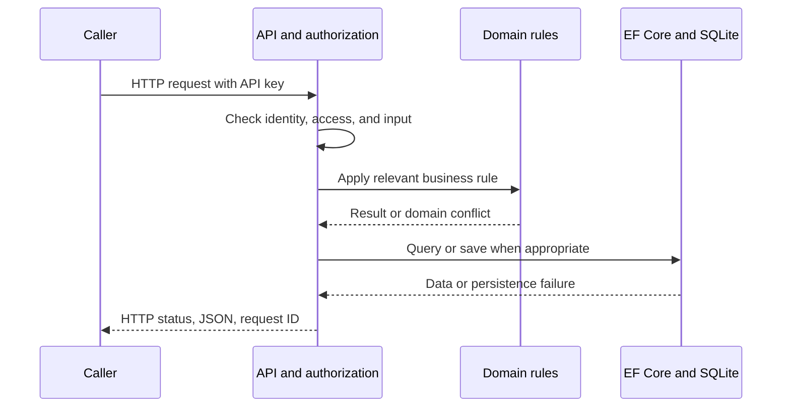

# 00: Your first session

**Outcome:** run one test, call the API, and identify the code responsible for a response. No prior ASP.NET knowledge required.

## Build a mental map

An HTTP client sends a request. `Atlas.Api` authenticates the caller and chooses an endpoint. The endpoint validates inputs and calls domain or database code. `Atlas.Domain` describes business rules; `Atlas.Infrastructure` persists data and coordinates payroll/leave workflows. The endpoint turns the result into JSON.



This is a simplified map; orchestration services can load data before applying rules, and a read endpoint may not invoke a domain method. Trace the specific operation rather than assuming every request follows every arrow.

Open [Program.cs](../../src/Atlas.Api/Program.cs), [CountryEndpoints.cs](../../src/Atlas.Api/Endpoints/CountryEndpoints.cs), and [CountryEndpointTests.cs](../../tests/Atlas.Tests/Integration/CountryEndpointTests.cs). Read only the country GET handler and one test first.

## Run from the repository root

```powershell
dotnet --version
dotnet restore Atlas.slnx
dotnet test Atlas.slnx --filter FullyQualifiedName~CountryEndpointTests
dotnet run --project src/Atlas.Api -- --urls http://localhost:5000
```

The SDK must support .NET 10. If `dotnet` is not found, check your installation and PATH using the [setup guide](../getting-started.md). The Development launch profile seeds local sample data. Keep the server running and open a second terminal.

```powershell
Invoke-RestMethod http://localhost:5000/health/live
$atlasHeaders = @{ 'X-Api-Key' = 'dev-admin-key' }
Invoke-RestMethod http://localhost:5000/api/countries -Headers $atlasHeaders
```

Use `curl.exe -i http://localhost:5000/api/countries` to see the anonymous 401 without PowerShell stopping on an HTTP error. Then repeat with `-H "X-Api-Key: dev-admin-key"`. Observe the status, JSON body, and `X-Request-Id` header. These are development credentials only.

## Predict before running

Request `/api/countries?page=0` with the admin key. Write your expected status and error field, then inspect the actual result. Find the call to `Pagination.Validate`. The request should fail before the list query is executed.

Set a debugger breakpoint in the GET handler. Inspect `page`, the claims principal, and the query. Step over the awaited database call. A query variable describes work; the awaited execution produces rows.

## Your deliverable

Write five sentences: the route, required identity, validation rule, database source, and output shape. Include the exact test command you ran. You are done when you can locate each sentence's evidence in the source without searching the whole solution again.

**Check yourself:** does a successful health check mean the caller may read payroll? Why does an API return a status code as well as a JSON body? Which project would you change to alter a country list's pagination defaults?

Next: [C# foundations](01-csharp-foundations.md).
